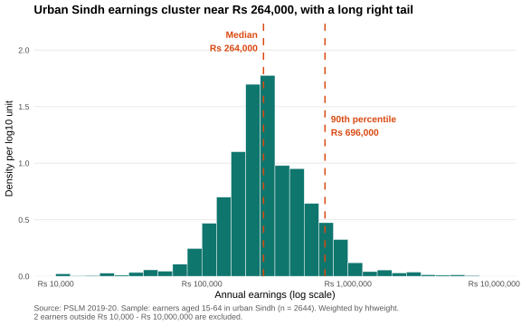
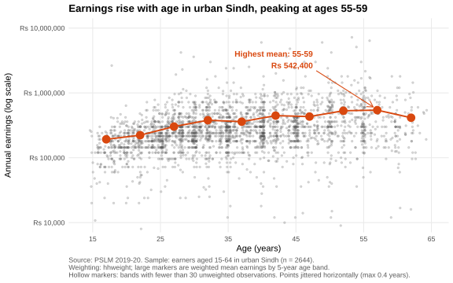
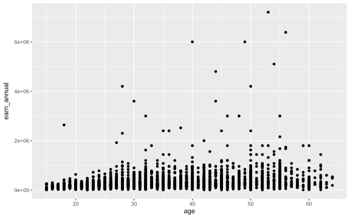
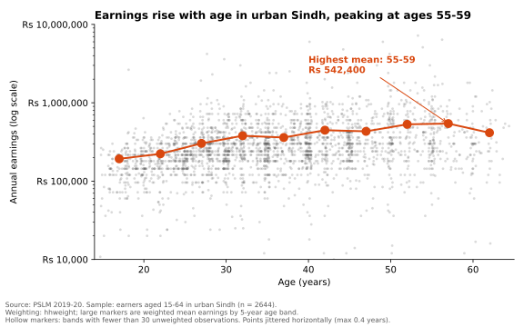

# ECO346-A1-FA24-BEDS-035

**Course:** ECO346 Data Visualization Techniques for Economists, Assignment 1 (Fall 2026)
**Registration no.:** FA24-BEDS-035 · **Section:** A
**Variant:** 35 = 4 × 8 + 3, so **variant 3 = Sindh, urban** (`prov_code` = 3, `urban_rural` = 2)

Data: PSLM 2019–20 person and household subset files (`data/`). Sample: persons aged 15–64 with `earn_annual` > 0 (earners), weighted by `hhweight`. **2,644 earners.**

## How to reproduce (no internet needed)

Run from the repository root.

```
install.packages(c("dplyr", "readr", "ggplot2", "svglite"))   # once, in R
Rscript scripts/01_default.R
Rscript scripts/02_distribution.R
Rscript scripts/03_relationship.R
python scripts/04_second_language.py                           # needs pandas, numpy, matplotlib
```

| Script | Output |
|---|---|
| `scripts/00_functions.R` | helpers (merge, weighted mean, weighted quantile, band table) |
| `scripts/01_default.R` | `figures/default.svg` (Q4, R defaults) |
| `scripts/02_distribution.R` | `figures/distribution.svg` (Q2) |
| `scripts/03_relationship.R` | `figures/relationship.svg` (Q3 and the Q4 redesign), `results/band_table_R.csv` |
| `scripts/04_second_language.py` | `figures/relationship_python.svg` (Q5); checks the band table against R |

## Question 2: the distribution



| Statistic | Value |
|---|---|
| Earners | 2,644 |
| Weighted median | Rs 264,000 |
| Unweighted median | Rs 252,000 |
| Weighted 10th percentile | Rs 120,000 |
| Weighted 90th percentile | Rs 696,000 |
| P90 / P10 | 5.80 |
| Excluded (outside Rs 10,000–10,000,000) | 2 |

**Interpretation.** Earnings of urban Sindh earners pile up around Rs 264,000 with a long right tail: the 90th percentile (Rs 696,000) is 5.80 times the 10th (Rs 120,000). The weighted median is Rs 12,000 above the unweighted Rs 252,000 because households carry unequal survey weights; hhweight restores population shares, so the weighted figure is the one that describes urban Sindh.

## Question 3: the relationship



| Band | Earners | Weighted mean earnings (Rs) |
|---|---|---|
| 15–19 | 160 | 192,523 |
| 20–24 | 296 | 222,948 |
| 25–29 | 398 | 303,154 |
| 30–34 | 396 | 379,254 |
| 35–39 | 359 | 360,221 |
| 40–44 | 344 | 446,533 |
| 45–49 | 250 | 431,697 |
| 50–54 | 212 | 530,773 |
| 55–59 | 157 | 542,400 |
| 60–64 | 72 | 414,262 |

No band has fewer than 30 observations, so no marker is hollow. Weighted mean of **25–29: Rs 303,154**; of **45–49: Rs 431,697**; the **highest band is 55–59 (Rs 542,400)**.

**Interpretation.** Average earnings rise with age, from Rs 192,523 at 15–19 to Rs 542,400 at 55–59 (2.8 times), then fall to Rs 414,262 at 60–64. That fits returns to experience and seniority, but it also reflects who is working at each age. Earnings vary widely within every band. The figure cannot tell us how one worker's earnings change over time: it compares different people in a single year (cohort effects) and only includes people still earning (selection).

## Question 4: the makeover

Default (`figures/default.svg`, committed first) and redesign (`figures/relationship.svg`):



**Explanation.** The default plots 2,644 points on a linear axis: a few earners above Rs 2 million stretch the scale, most people are crushed into a thin band, and overplotting hides density. Three changes follow. First, a log scale (log-scale principle) makes equal distances mean equal ratios and spreads the bulk of earners. Second, jitter of at most 0.4 years and 22% opacity (overplotting) reveal where points stack. Third, weighted band means joined by a line, with the peak annotated directly (conditional means, data–ink), turn a cloud into a readable age profile; I also removed the grey panel and wrote the axis in rupees. What the default shows that my redesign hides: the extreme tail. Earners at Rs 5–7.2 million stand far above everyone else on the linear axis, but the log axis compresses them.

## Question 5: second language (Python)



Band mean for 25–29: **R Rs 303,154, Python Rs 303,154** (the script asserts that all ten bands agree to the rupee).

**Note.** R and Python both give Rs 303,154 for ages 25–29. Defaults that differed: matplotlib draws opaque points, shows all four spines, labels the log axis as powers of ten and picks its own y-range, whereas my ggplot sets these differently. I set alpha to 0.22, hid the top and right spines, wrote tick labels in rupees and fixed the y-range to Rs 10,000–10,000,000. Jitter draws differ, but band means do not.
